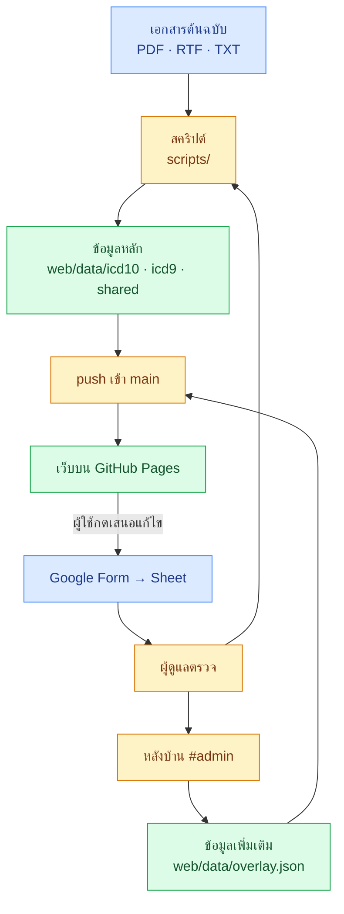
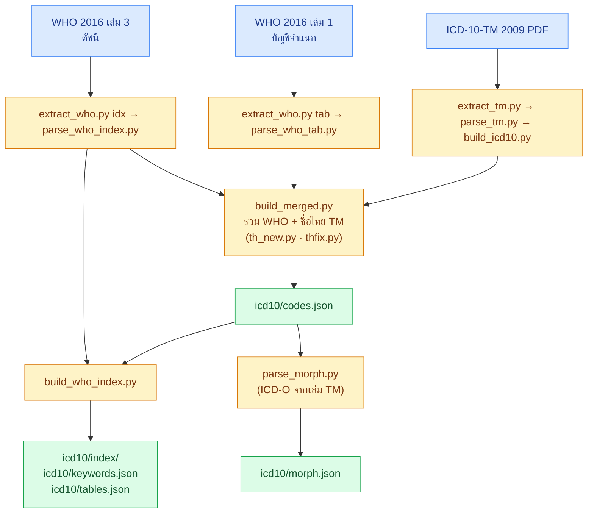
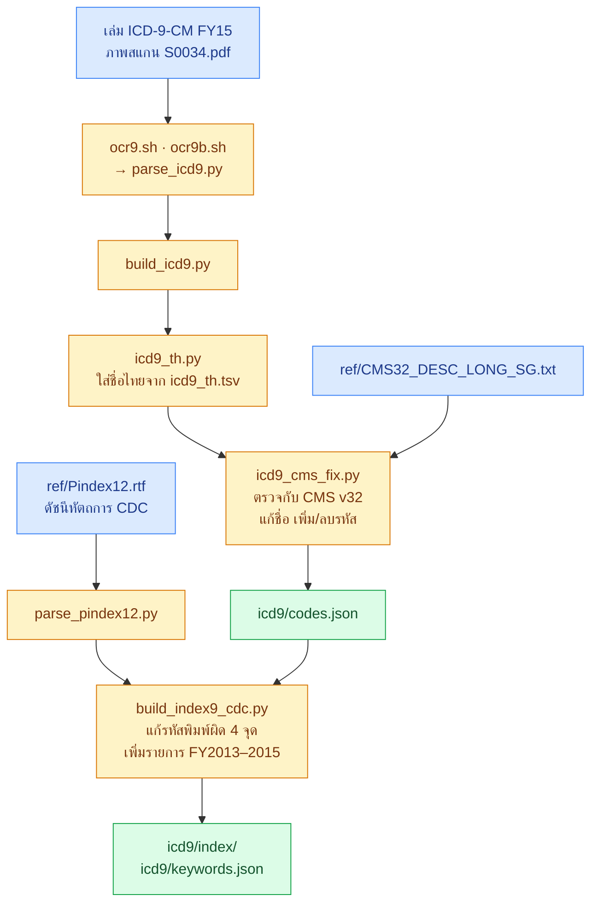
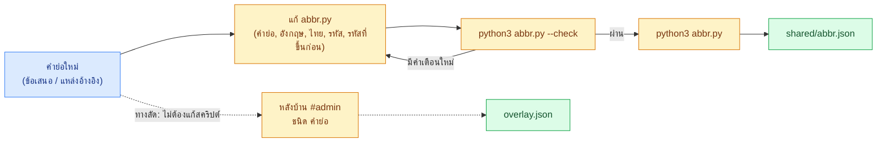
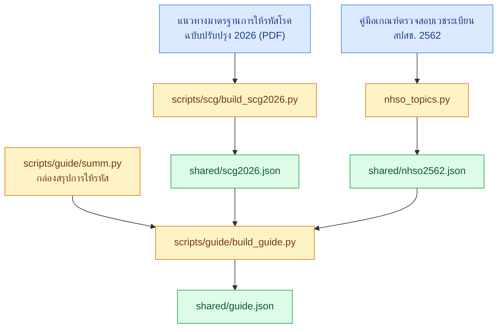
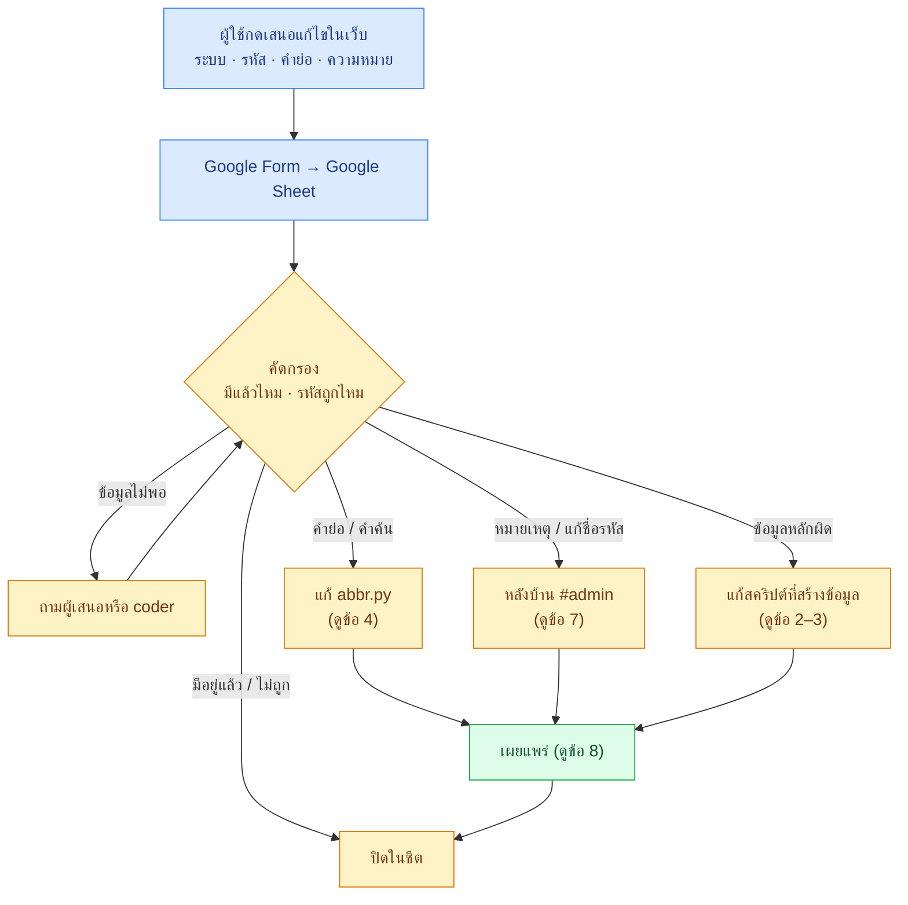
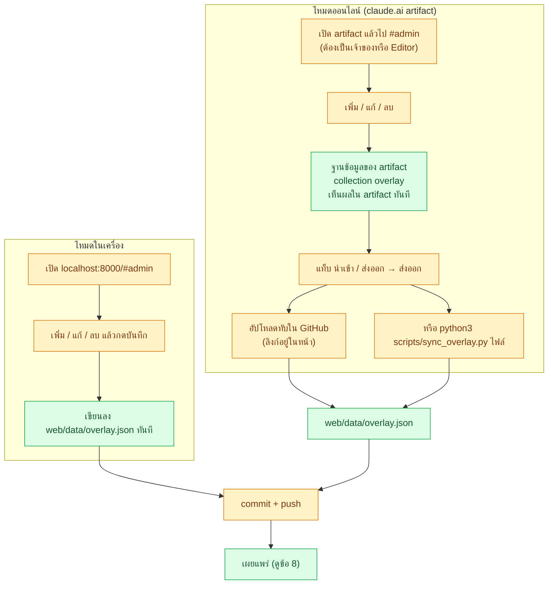
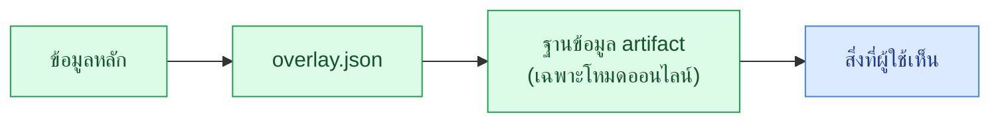
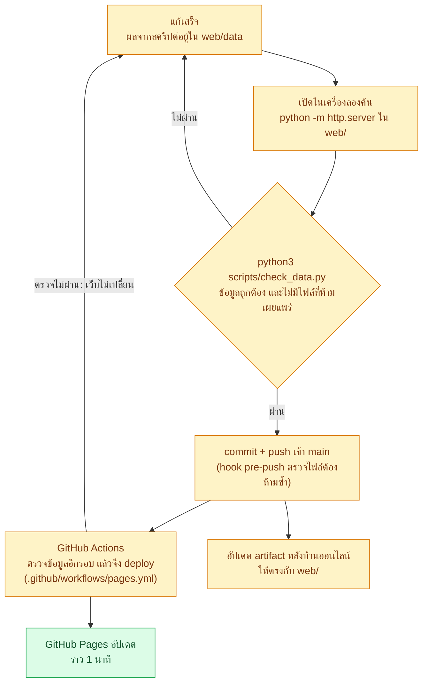

# Flow ของงานทั้งหมด

หน้านี้แสดงว่าแต่ละงานเริ่มจากไหน ผ่านไฟล์หรือสคริปต์อะไร และไปจบที่ไหน แผนภาพทุกรูป GitHub วาดให้เอง ถ้าต้องการรายละเอียดของแต่ละขั้น ให้ดูไฟล์ที่ลิงก์ไว้

| # | งาน | ใช้เมื่อ |
|---|---|---|
| 1 | [ภาพรวม](#1-ภาพรวม) | อยากเห็นทั้งระบบในรูปเดียว |
| 2 | [ข้อมูล ICD-10](#2-ข้อมูล-icd-10) | สร้างรหัส ดัชนี ตาราง ICD-10 ใหม่ |
| 3 | [ข้อมูล ICD-9-CM](#3-ข้อมูล-icd-9-cm) | สร้างรหัส ชื่อไทย ดัชนีหัตถการใหม่ |
| 4 | [คำย่อ](#4-คำย่อ) | เพิ่มหรือแก้คำย่อ |
| 5 | [หน้าแนวทาง](#5-หน้าแนวทาง) | แก้แนวทางการให้รหัส เกณฑ์ สปสช. หรือกล่องสรุป |
| 6 | [ข้อเสนอจากผู้ใช้](#6-ข้อเสนอจากผู้ใช้) | ตรวจข้อเสนอที่ส่งมาทางฟอร์ม |
| 7 | [หลังบ้าน](#7-หลังบ้าน-admin) | เพิ่มหมายเหตุ แก้ชื่อรหัส โดยไม่แตะข้อมูลหลัก |
| 8 | [เผยแพร่](#8-เผยแพร่) | เอาสิ่งที่แก้ขึ้นเว็บ |

สีในแผนภาพ: 🟦 ไฟล์ต้นฉบับ 🟨 สคริปต์หรือคนทำ 🟩 ไฟล์ข้อมูลที่เว็บใช้

---

## 1. ภาพรวม

ข้อมูลมี 2 ชั้น **ข้อมูลหลัก** สร้างจากเอกสารด้วยสคริปต์ ห้ามแก้มือ ส่วน **ข้อมูลเพิ่มเติม** (overlay) แก้ผ่านหลังบ้าน และทับข้อมูลหลักตอนแสดงผล

---

## 2. ข้อมูล ICD-10

รหัสและชื่ออังกฤษยึด WHO 2016 ชื่อไทยและหมายเหตุสองภาษามาจาก ICD-10-TM 2009 สคริปต์อยู่ใน `scripts/who_icd10/` และ `scripts/tm_icd9_nhso/`

ลำดับรัน: `build_merged.py` ก่อน แล้วจึง `build_who_index.py` และ `parse_morph.py` (สองตัวหลังอ่าน `codes.json`)

---

## 3. ข้อมูล ICD-9-CM

รายการรหัสมาจาก OCR ของเล่ม FY15 แล้วตรวจกับรายการทางการของ CMS ส่วนดัชนีสร้างจากไฟล์ทางการของ CDC ไม่ใช้ OCR สคริปต์อยู่ใน `scripts/tm_icd9_nhso/`

- `build_icd9.py` เรียก `icd9_th.py` และ `icd9_cms_fix.py` ให้เอง รันคำสั่งเดียวพอ
- **แก้ชื่อไทย:** แก้ `icd9_th.tsv` แล้วรัน `build_icd9.py` ใหม่
- `build_index9_cdc.py` ต้องรันหลัง `codes.json` เสร็จ เพราะใช้ตรวจว่ารหัสในดัชนีมีจริง

---

## 4. คำย่อ

- รหัสในคำย่อเขียนได้ 3 แบบ: `@E11` (รหัสนั้นและรหัสย่อย), `@A-B` (ช่วงรหัส), หรือข้อความที่ต้องตรงกับชื่อรหัส
- `--check` แจ้งรูปแบบที่ไม่เจอรหัสเลย คำเตือนเดิม 14 ข้อเป็นเรื่องปกติ ให้ดูเฉพาะข้อที่เพิ่มขึ้น
- คำย่อเดียวมีหลายความหมายได้ (เช่น BSO, ET) ใส่เป็นคนละแถว

---

## 5. หน้าแนวทาง

**แก้กล่องสรุป:** แก้ `summ.py` แล้วรัน `ICD_DATA=web/data python3 scripts/guide/build_guide.py`

---

## 6. ข้อเสนอจากผู้ใช้

ปุ่มเสนอแก้ไขอยู่ที่หน้ารายละเอียดรหัส ("เสนอแก้ไขรหัสนี้"), ตอนค้นไม่เจอ ("เสนอเพิ่มคำย่อ") และท้ายหน้า ที่อยู่ฟอร์มตั้งใน `web/data/shared/feedback.json` สร้างฟอร์มใหม่ได้ด้วย `scripts/feedback/create-form.gs`

---

## 7. หลังบ้าน (#admin)

หลังบ้านมี 2 โหมด ขึ้นกับว่าเปิดจากที่ไหน ทั้งสองโหมดจบที่ไฟล์ `web/data/overlay.json` ใน repo

ตอนแสดงผล หน้าเว็บรวมข้อมูลตามลำดับนี้ ชั้นหลังทับชั้นหน้าเมื่อ id ตรงกัน:

- ลบรายการใน overlay เมื่อไร ก็กลับไปเป็นข้อมูลหลัก
- ปุ่มลบต้องกด 2 ครั้งภายใน 4 วินาที
- รูปแบบข้อมูลแต่ละชนิดดูใน [`backend.md`](backend.md)

---

## 8. เผยแพร่

- ถ้าแก้แค่ `scripts/` หรือ `docs/` เว็บจะไม่ deploy ใหม่ เพราะหน้าเว็บไม่เปลี่ยน แต่ `check.yml` ยังตรวจข้อมูลทุกครั้งที่ push
- เปิด hook ตรวจก่อน push ครั้งเดียวต่อเครื่อง: `git config core.hooksPath scripts/hooks`
- **ห้ามขึ้น GitHub:** ไฟล์ PDF ต้นฉบับ และเอกสารที่ใช้ภายในโรงพยาบาลเท่านั้น
- วิธีเผยแพร่แบบอื่น (Netlify, Cloudflare Pages) ดูใน [`deploy.md`](deploy.md)
